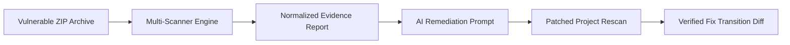

# VantaScan — Full-Stack AI Security Reviewer

VantaScan is a security review and fix-verification platform designed for applications developed with AI coding assistants (Gemini, Claude, Cursor, Copilot). It bridges the gap between automated static security scanners and generative AI remediation by combining multi-scanner audits, automated secret redaction, and a rescan verification engine.

---

## 🌟 The Complete Security Lifecycle



1. **Intake & Multi-Scanner Audit**: Upload a repository archive or run passive HTTP/HTTPS header inspection.
2. **Deterministic Evidence Extraction**: Gitleaks, Semgrep, Trivy, and the Static Security Rule Engine detect flaws with exact line numbers and code snippets.
3. **Secret Redaction**: Credentials (Gemini keys, AWS secrets, JWTs, Stripe tokens) are masked at the boundary before AI ingestion or persistence.
4. **AI Repair Prompt Synthesis**: Gemini synthesizes a 10-section prompt for coding agents.
5. **Rescan & Fix Verification**: A patched ZIP is evaluated against the baseline to verify resolutions.

---

## 🛡️ Key Features

- **Multi-Scanner Architecture**:
  - **Gitleaks**: Secret detection with automated redaction.
  - **Trivy**: Dependency vulnerabilities, secret detection, and misconfigurations.
  - **Semgrep**: Static application security testing (SAST) for JavaScript/TypeScript.
  - **Static Security Rule Engine**: Deterministic fallback engine executing AST-style security heuristics.
  - **Passive URL Inspector**: SSRF-protected HTTP response header and cookie attribute auditor.
- **Provider-Independent AI Remediation**:
  - Integrates with Google Gemini models (configurable via `GEMINI_MODEL`).
  - Strict JSON schema constraints for model responses.
  - Deterministic fallback engine ensures full feature availability even when no API key is configured.
- **Rescan Verification Engine**:
  - Categorizes findings into: `Resolved`, `Still Present`, `New`, or `Inconclusive`.
  - **Failure Defense**: A scanner execution error never falsely marks a finding as resolved.
- **Security Boundaries**:
  - **ZipSlip Prevention**: Strict rejection of `..` paths, absolute paths, and null bytes.
  - **SSRF Defense**: Target URL verification blocking loopback (`127.0.0.1`), RFC1918 private subnets, and cloud metadata (`169.254.169.254`).
  - **Credential Redaction**: Regex-based masking protecting persistence, AI prompts, and frontend bundles.

---

## 🚀 Quick Start Guide

### Prerequisites
- **Node.js**: v20+ (Tested on Node.js v26)
- **npm**: v10+
- **macOS Scanner Binaries** (Optional but recommended):
  ```bash
  brew install gitleaks trivy semgrep
  ```
  *Note: If any scanner is missing, VantaScan indicates this in the dashboard and runs available scanners along with the built-in Rule Engine.*

### 1. Installation
Clone the repository and install dependencies across all workspaces:
```bash
npm install
```

### 2. Environment Configuration
Copy the example environment file:
```bash
cp .env.example .env
```
Edit `.env` to configure your Gemini API Key and model identifier:
```dotenv
GEMINI_API_KEY=your_gemini_api_key_here
GEMINI_MODEL=gemini-2.5-flash
PORT=4000
MAX_UPLOAD_SIZE_MB=25
MAX_EXTRACTED_FILES=500
MAX_EXTRACTED_BYTES_MB=50
SCAN_TIMEOUT_MS=60000
```
> **Security Reminder**: `.env` is listed in `.gitignore`. Never commit API keys or production secrets to source control.

### 3. Launch Development Servers
Run backend and frontend concurrently:
```bash
npm run dev
```
Or start each service individually:
- **Backend API Server**:
  ```bash
  npm run dev --workspace=backend
  # Listening on http://localhost:4000
  ```
- **Frontend Dashboard**:
  ```bash
  npm run dev --workspace=frontend
  # Accessible at http://localhost:3000
  ```

---

## 🧪 Testing and Verification

### Run Automated Unit & Integration Tests
VantaScan includes a comprehensive Vitest suite covering secret redaction, ZipSlip rejection, scanner error defenses, rescan transitions, and SSRF boundary checks:
```bash
npm run test --workspace=backend
```

### Run Demonstration Fixtures (1-Click Workflow)
Pre-packaged demonstration test fixtures are provided in `fixtures/`:
1. **Vulnerable Baseline App**: Open `http://localhost:3000` and click **"Run Vulnerable Demo Scan"** (or upload `fixtures/vulnerable-app.zip`).
   - Gitleaks and the Rule Engine identify hardcoded credentials, dynamic `eval()` execution, unauthenticated administrative routes, and wildcard CORS policies.
2. **AI Remediation Workspace**: Review the generated roadmap and copy the 10-section AI coding prompt.
3. **Rescan Fix Verification**: Navigate to **Rescan Comparison** and click **"Test with Pre-Packaged Corrected Demo Fixture"** (or upload `fixtures/corrected-app.zip`).
   - All 5 baseline vulnerabilities are verified as **Resolved** with transition explanations.

---

## 📡 API Reference

| Endpoint | Method | Description |
|---|---|---|
| `/api/health` | `GET` | Service status, uptime, and Gemini AI configuration status |
| `/api/scanners` | `GET` | Real-time scanner binary availability on host |
| `/api/scans/upload` | `POST` | Upload and scan a source-code ZIP archive (`multipart/form-data`) |
| `/api/scans` | `GET` | List all previous scan records |
| `/api/scans/:id` | `GET` | Retrieve findings and summary for a scan |
| `/api/scans/:id/remediation` | `GET` | Generate structured AI remediation plan |
| `/api/scans/:id/prompt` | `GET` | Retrieve ready-to-paste AI prompt (supports `?download=true`) |
| `/api/scans/:id/rescan` | `POST` | Upload patched ZIP, rescan, and compare against baseline `:id` |
| `/api/comparisons/:id` | `GET` | Retrieve rescan comparison diff and status transitions |
| `/api/fixtures/scan-demo` | `POST` | Run 1-click test fixture scans (`mode: "vulnerable" \| "corrected"`) |

---

## ⚠️ Prototype Limitations

1. **Static Analysis Scope**: Automated SAST tools and secret scanners detect syntax patterns and signatures; they do not guarantee runtime security or replacement of manual penetration testing.
2. **AI Guidance Grounding**: AI-generated explanations are derived directly from scanner findings. Suggestions not corroborated by scanner evidence are flagged as unverified hypotheses.
3. **Passive URL Inspection**: Only HTTP response headers and cookie flags are audited. Active penetration testing or vulnerability exploitation (e.g., OWASP ZAP) is intentionally omitted.
4. **Credential Rotation Requirement**: Removing a hardcoded secret from source code eliminates repository exposure but does not invalidate an already leaked credential; manual provider rotation remains mandatory.
